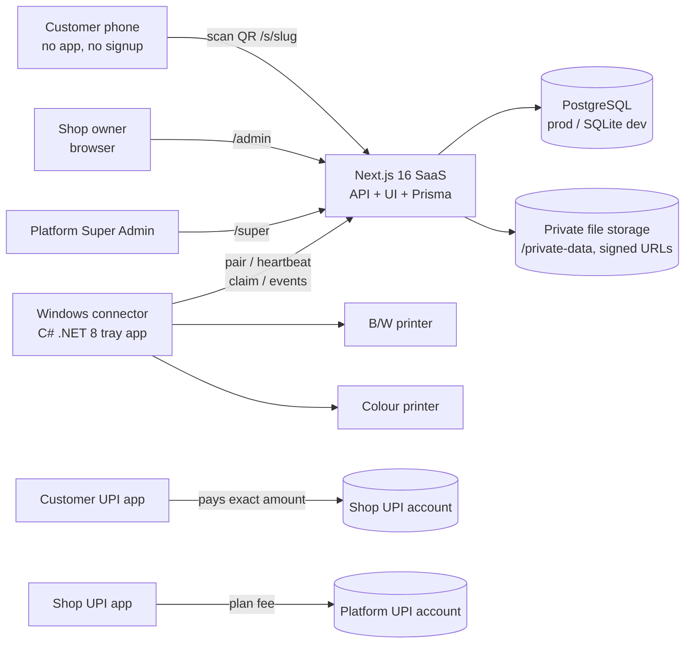
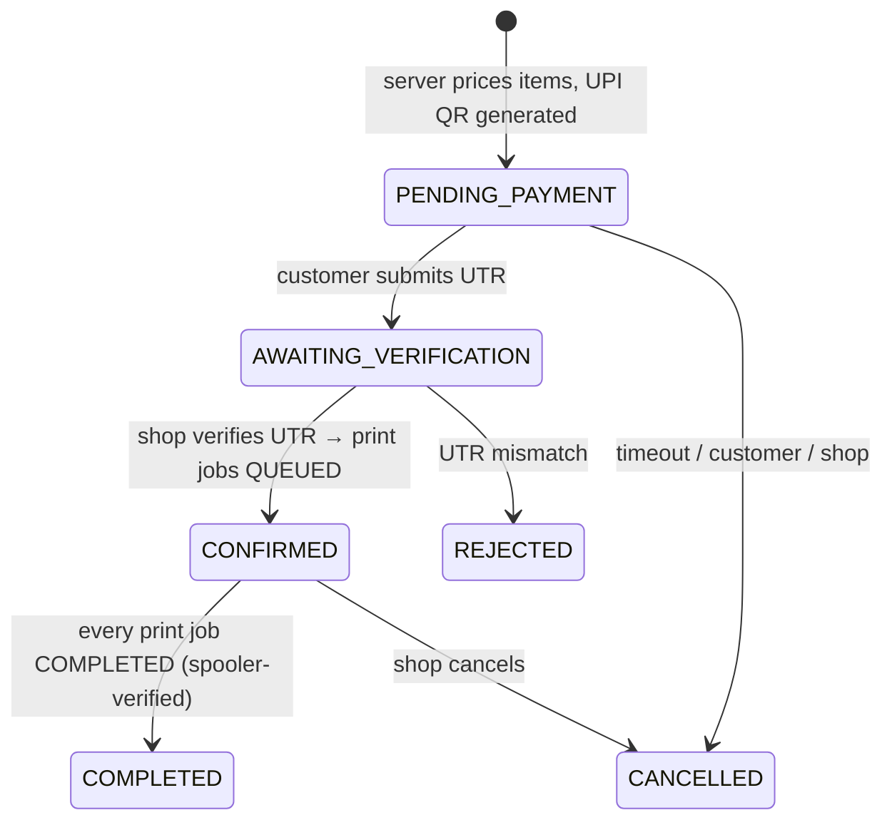
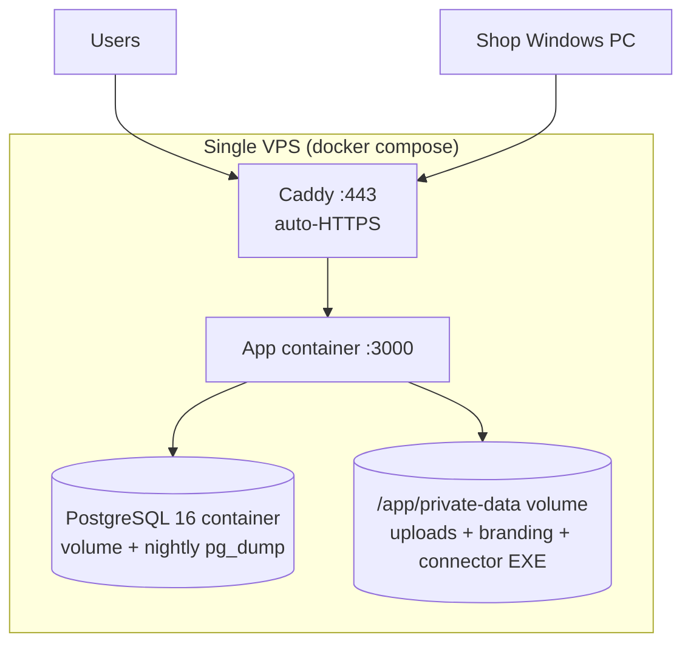

# System Architecture

## Context



Payment never touches the platform's servers — the UPI QR encodes the **shop's own VPA**
with the exact amount, so money moves bank-to-bank. The platform only records references
(UTR) and verification decisions, keeping the system payment-gateway-free and commission-free.

## Order lifecycle (state machine)



Print job states: `QUEUED → CLAIMED (10-min lease) → SPOOLING → COMPLETED | FAILED`
(auto-requeue while `attempts < maxAttempts`; manual requeue by shop).

## Print job flow

```mermaid
sequenceDiagram
    participant O as Order (CONFIRMED)
    participant A as SaaS API
    participant D as Windows connector
    participant W as Windows spooler
    A->>A: enqueuePrintJobs() — colour/size routing rules
    D->>A: heartbeat every ~20 s (printer inventory upsert)
    D->>A: POST /api/device/jobs/claim
    A-->>D: job + 30-min signed download URL (10-min lease taken)
    D->>A: GET signed URL → stores temp file
    D->>D: PDF rasterised (pdfium, 220 DPI) / image loaded
    D->>D: B/W → GDI+ grayscale, duplex/copies/paper set on PrintDocument
    D->>W: Print() with DocumentName = "PCS-<order>-<item>"
    D->>A: event SPOOLING
    D->>W: EnumJobs poll — job leaves queue or JOB_STATUS_COMPLETE
    D->>A: event COMPLETED (only now; server rejects COMPLETED w/o SPOOLING)
    A->>A: all jobs done → order COMPLETED
```

## Deployment topology (production)



Horizontal scale notes: the rate limiter is in-memory per instance — swap for Redis when
running >1 replica (documented in SECURITY.md).
